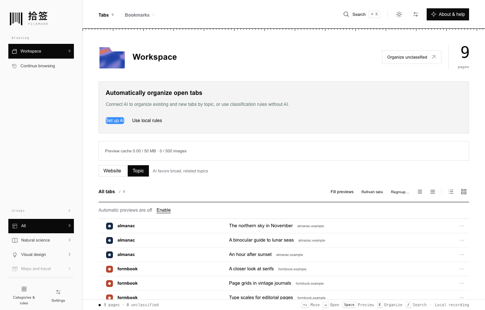
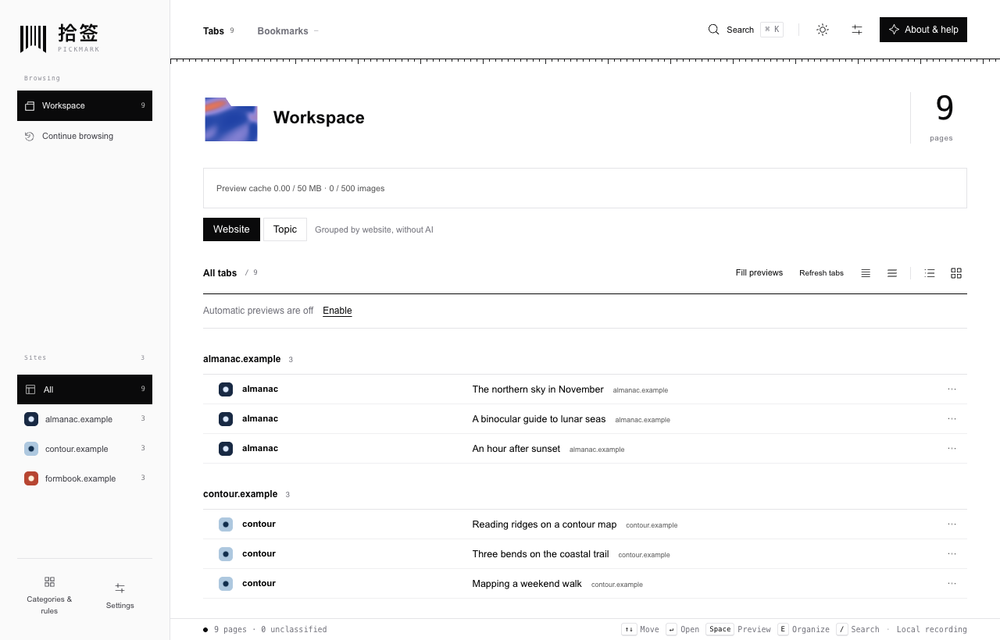
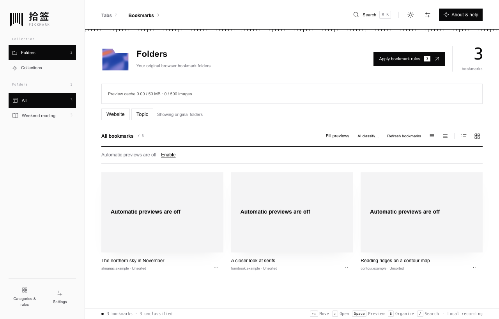
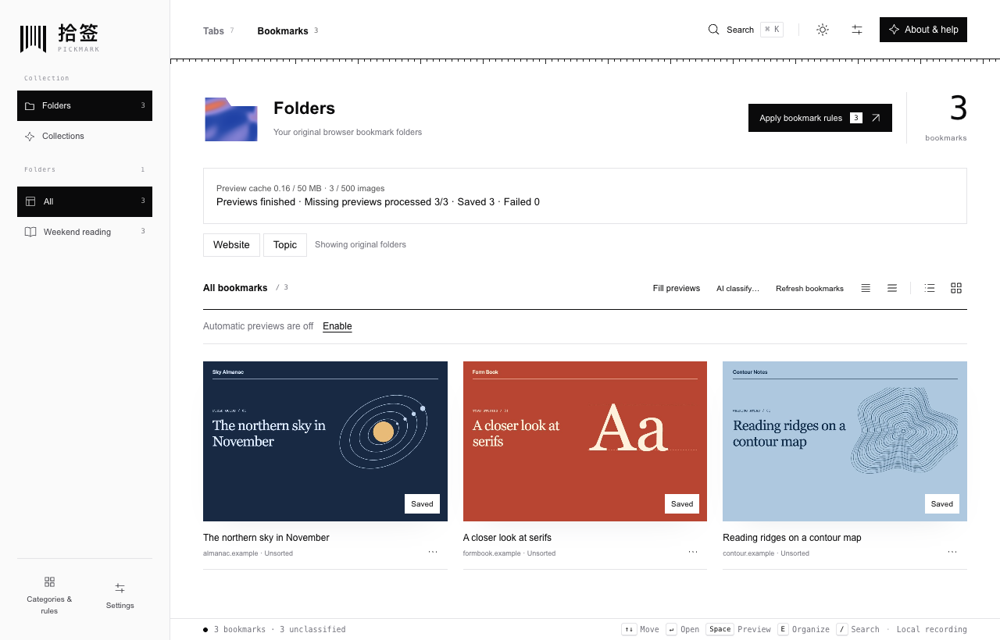
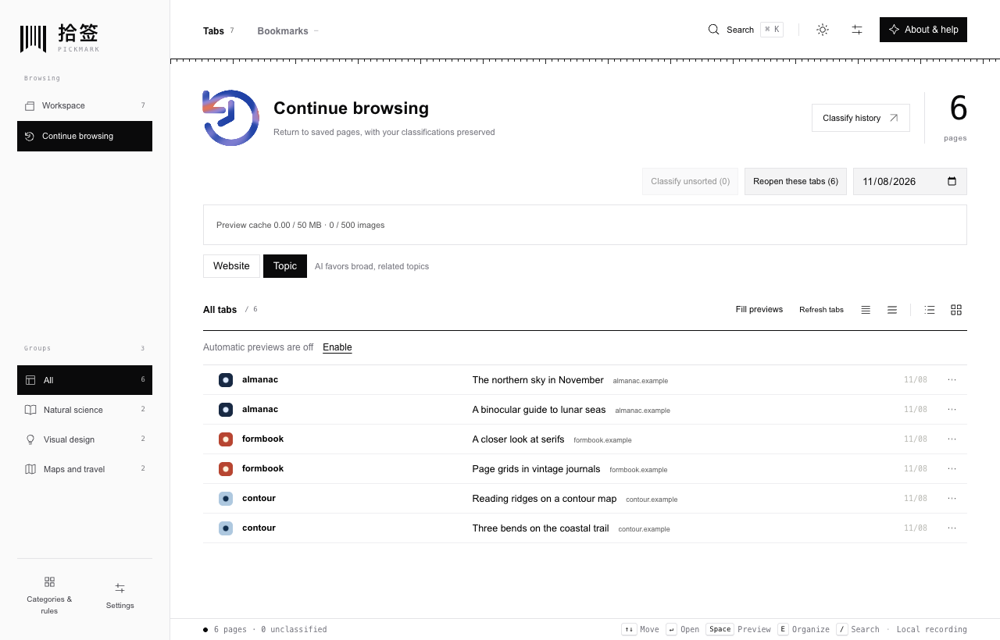

# Pickmark · 拾签

[简体中文](README.md) | **English**

Pickmark is a desktop Chrome extension for finding your way back to open tabs. Group articles from the same site together, or organize research from several sites under one topic. The next day, open **Continue browsing** to pick up a page from yesterday’s list.

**Latest release · 0.1.22.** This version adds website grouping and background preview capture since the previous public release. All screenshots show this version. [Download Pickmark 0.1.22](https://github.com/abelguan02/Pickmark/releases/download/v0.1.22/Pickmark-0.1.22.zip) · [Release notes and SHA-256 checksum](https://github.com/abelguan02/Pickmark/releases/tag/v0.1.22)

## Find pages by website or topic

- **Website** groups pages by domain. Select a site in the sidebar to see its pages. This view works without AI and preserves each page’s topic assignment.
- **Topic** brings together pages from different sites. In **Categories & rules**, match a keyword in a title or domain to a category, or change one page’s category by hand. For optional AI classification, add your own provider key in Settings. Automatic organization preserves manual assignments. **Regroup** asks you to confirm the scope before it reevaluates pages.
- **Tabs and bookmarks** remember their grouping modes separately. Select a tab entry to return to the open tab. Grant bookmark access to browse Chrome’s original folders or categorize bookmarks within Pickmark. Bookmark AI asks you to confirm its scope. Chrome keeps its folder structure and tab order.

## What does the gallery show before a page has a preview?

Automatic preview capture starts off. The three bookmarks below belong to the **Weekend reading** folder, and the cache holds **zero images**. Each card shows the page title, site, and “Automatic previews are off.” You can already open a page by clicking its card.

Choose **Fill previews** and grant screenshot access. Pickmark opens a muted background tab in the current window and visits pages missing a preview in the current list. For bookmarks, it processes only the current page of results. Version 0.1.22 adds Chrome’s required `debugger` permission and attaches only to the temporary tab created for this job. Chrome displays a debugging banner during capture. You can keep your window at its usual size. Here is the same folder after all three captures.

- You can cancel a batch and keep pictures already saved. Pickmark skips existing previews, known webmail sites, and domains on your exclusion list. Background visits use the current Chrome profile’s sign-in state and may appear in Chrome’s own history.
- Filling previews once leaves automatic capture off if it was off before. To save previews as you browse, enable automatic capture in Settings. Images stay on this device for up to **7 days**, with limits of **500 images and 50 MB**. Clear them in **Data & storage**.
- Switch to the compact or comfortable list to see more titles at once. The interface supports Chinese and English, with light, dark, and system appearance.

## Return to yesterday’s pages

**Continue browsing** opens yesterday’s list by default. Choose another date to look further back. Open one page or reopen the set, skipping tabs that are already open. **Classify history** applies local rules to unsorted historical pages and lets you choose whether to use AI for the rest.

Version 0.1.21 removed Daily review, duration estimates, and tab-switching paths. Daily lists retain the URLs and categories of pages that were open when collected. All tabs, bookmarks, historical entries, and websites in these screenshots were created for this demonstration.

## Install the public release

1. Download and extract [Pickmark-0.1.22.zip](https://github.com/abelguan02/Pickmark/releases/download/v0.1.22/Pickmark-0.1.22.zip). Keep the extracted folder in a permanent location.
2. Open `chrome://extensions` in desktop Chrome, enable **Developer mode**, and select **Load unpacked**. Choose the folder that directly contains `manifest.json`. If you downloaded the entire repository as a source ZIP, select its `extension/` subfolder.
3. Pin Pickmark in Chrome’s Extensions menu and click its icon to open the workspace, or select Pickmark in Chrome’s side panel. To update an existing installation, replace the program files in the original folder and click **Reload** on the same extension. Uninstalling deletes the extension’s local data. [0.1.22 installation and update guide](docs/INSTALL-UPDATE-0.1.22.md)

## Data and privacy in 0.1.22

| Data | How Pickmark handles it |
| --- | --- |
| Daily page lists | Recording starts enabled and continues locally when the dashboard is closed. Records include titles, full URLs, and categories. Choose 7, 14, or 30 days of retention, with 30 as the default. A target of 5,000 records and about 4 MB can trim older entries sooner. Pause recording, exclude sites, or clear records in Settings. |
| AI classification | Local rules and manual grouping work without a key. When AI is enabled, Pickmark sends titles, domains, and classification context directly to your provider, which may charge for requests. Requests omit screenshots and page bodies. A visible topic workspace with recording enabled automatically processes candidates in batches of up to 200 pages. |
| Keys and backups | Provider keys stay in this browser’s local extension storage. Rule backups can include saved AI preferences. Page records, images, and API keys are excluded from those backups. |

Available providers include DeepSeek, OpenAI, Anthropic Claude, Google Gemini, Qwen, and Kimi. Upgrading from a version with duration tracking to 0.1.21 or later clears legacy timing data. For collection, permissions, and deletion controls, see the [privacy notes](PRIVACY.md).

## About the project

Pickmark was previously named Tabtrail. Its original idea, **Attention Atlas**, grew from a familiar question at the end of a day with dozens of tabs open. Which pages did I mean to come back to?

The Manifest V3 extension has no third-party npm runtime dependencies. For development, use Node.js 20+ and run `npm test` and `npm run check` from the repository root. Please use fictional examples in public issues and keep private titles, URLs, and API keys out of reports. [Contributing](CONTRIBUTING.md) · [Issues](https://github.com/abelguan02/Pickmark/issues) · [MIT license](LICENSE)
