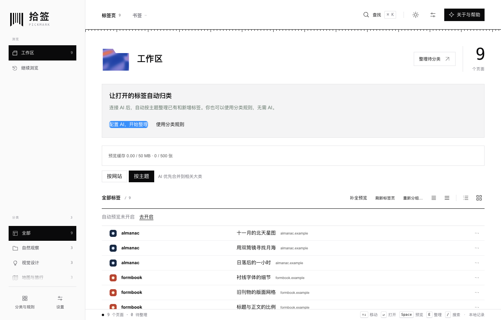
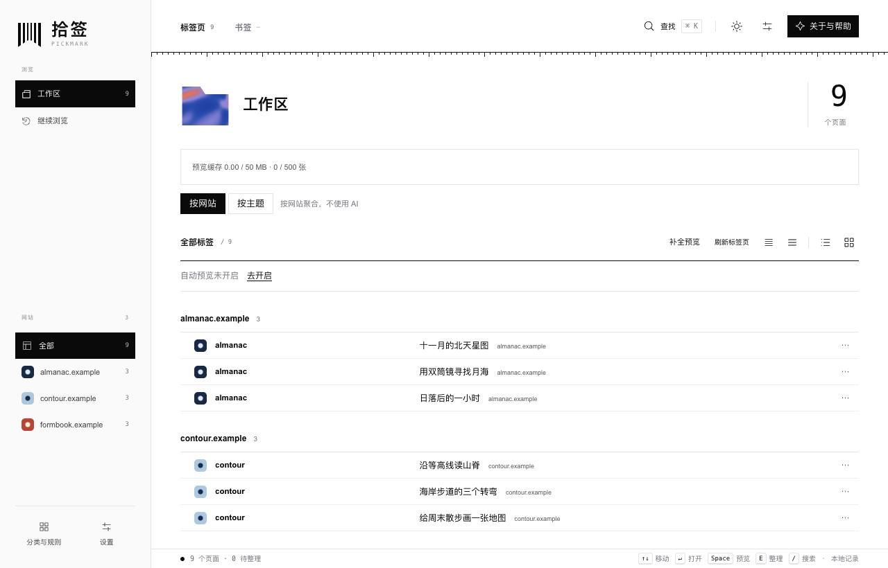
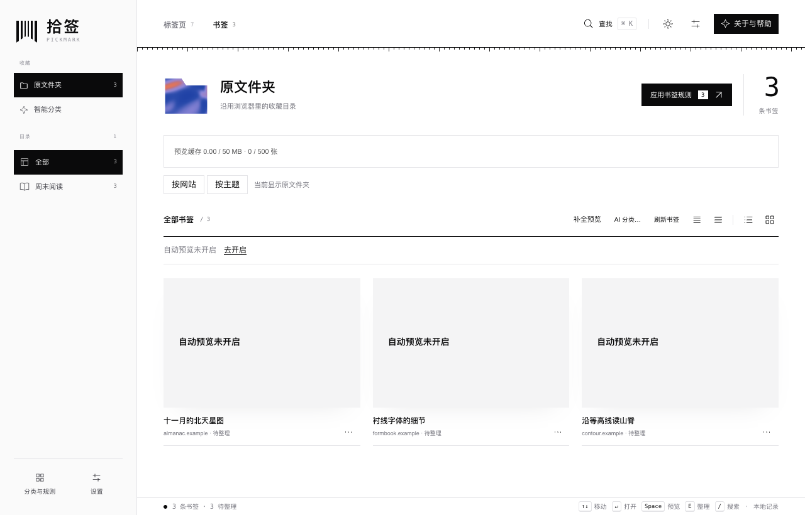
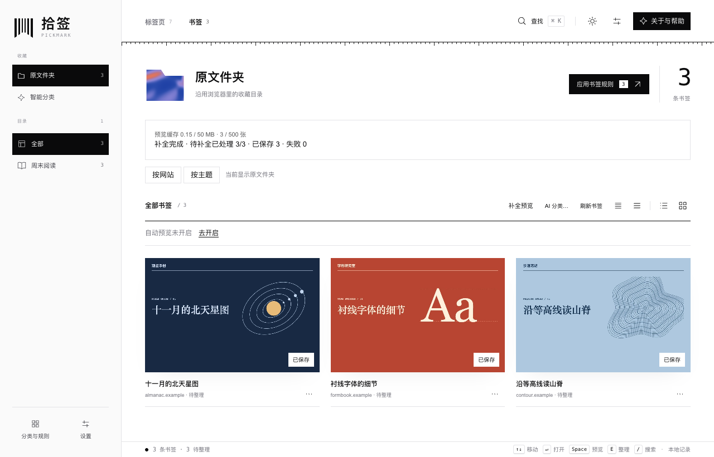
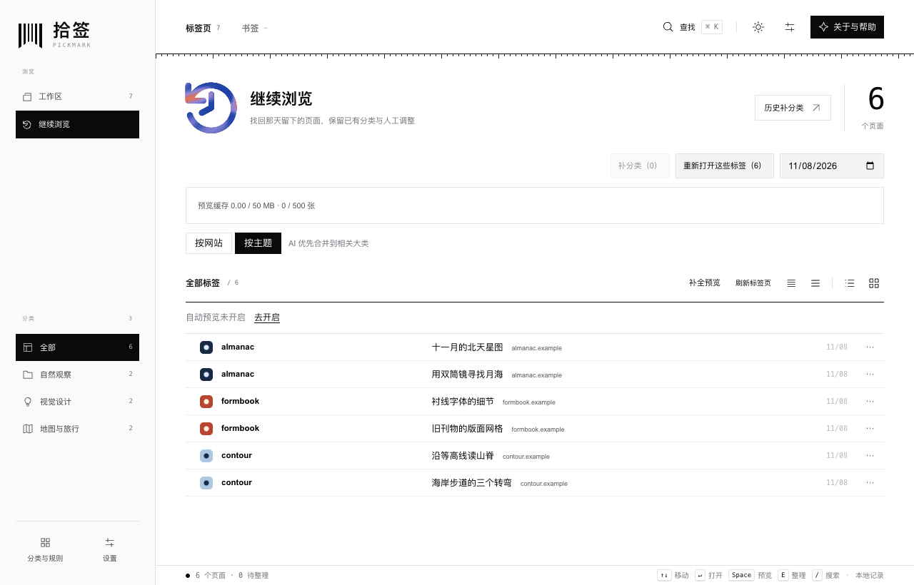

# 拾签 · Pickmark

**简体中文** | [English](README.en.md)

拾签是一个桌面 Chrome 扩展。打开的标签页多了，可以按网站找回同一站点的几篇文章，也可以把不同网站的资料放进同一个主题。隔天打开「继续浏览」，还能从昨天的页面清单接着读。

**最新版 0.1.22** 支持按网站整理和后台补全预览。下图均来自本版本。[下载 0.1.22 安装包](https://github.com/abelguan02/Pickmark/releases/download/v0.1.22/Pickmark-0.1.22.zip) · [发布说明与 SHA-256 校验文件](https://github.com/abelguan02/Pickmark/releases/tag/v0.1.22)

## 按网站找页面，按主题整理资料

- **按网站**把同域名的页面放在一起。从左侧选择一个网站就能缩小列表。这个视图无需 AI，切换时会保留原有的主题分类。
- **按主题**可以跨网站归类。在「分类与规则」里把标题或域名关键词指向一个分类，也可以直接调整某一页的归属。需要 AI 时，再在设置中添加自己的供应商 Key。日常自动整理会保留手动归属，「重新分组」则会让你先确认范围。
- **标签页和书签**分别记住整理方式。点击标签页条目可回到原标签；授权读取书签后，可以沿用 Chrome 的原文件夹，也可以在拾签里为书签独立分类。书签 AI 分类单独确认范围，原目录和浏览器中的标签顺序都会保留。

## 没有网站预览图时是什么样子？

自动保存网页预览默认关闭。下图的三条书签都来自「周末阅读」文件夹。缓存里有 **0 张图片**，画廊保留了每页的标题和网站，并显示「自动预览未开启」。这时已经可以点击卡片打开网页。

点一次 **补全预览** 并授予截图权限，拾签会在当前窗口新建一个静音的后台标签页，依次访问当前列表里缺图的网页；书签只处理当前分页。0.1.22 新增了 Chrome 的必需调试权限（`debugger`），只连接这次任务创建的临时标签页。补全期间 Chrome 会显示调试提示条，无需调整窗口大小。下图是同一文件夹完成后的样子，三张卡片均已显示网页实拍缩略图。

- 可以中途取消，已保存的图片会保留。已有预览、内置列表中的常见邮箱及你排除的网站会跳过。后台访问会使用当前 Chrome 的登录状态，也可能出现在 Chrome 自身的历史记录中。
- 批量补全和自动保存是两个独立选项。想在日常浏览时保存预览，可在设置中单独开启自动保存。图片只存在本机，最多 **500 张、50 MB，保留 7 天**，可在「数据与存储」里清理。
- 想看更多标题，可以从画廊切到紧凑列表或舒适列表。界面支持中文、English，以及浅色、深色和跟随系统。

## 隔天继续浏览

「继续浏览」默认展示昨天，也可以选择其他日期。点一页可回到该网址，批量恢复会跳过已经打开的页面。若当天还有待整理的资料，可使用「历史补分类」，先应用本地规则，再选择是否让 AI 处理剩余页面。

0.1.21 起已移除「每日回顾」、停留时长和切换轨迹。保留的每日清单记录采集时打开过的网页，恢复范围是网址和分类。截图中的标签、书签、历史记录和三个示例网站均为虚构演示数据。

## 安装公开版

1. 下载并解压 [Pickmark-0.1.22.zip](https://github.com/abelguan02/Pickmark/releases/download/v0.1.22/Pickmark-0.1.22.zip)，把解压后的文件夹放在准备长期保留的位置。
2. 在桌面 Chrome 打开 `chrome://extensions`，开启**开发者模式**，点击**加载已解压的扩展程序**，选择直接包含 `manifest.json` 的文件夹。如果下载的是整个仓库的源码 ZIP，请选择其中的 `extension/`。
3. 从工具栏扩展菜单固定拾签，点击图标打开工作区，也可从 Chrome 侧边栏选择拾签。已有安装时，将程序文件更新到原加载目录，再点击原扩展的**重新加载**，以保留本地数据。卸载会删除扩展的本地数据。[0.1.22 安装与更新说明](docs/INSTALL-UPDATE-0.1.22.md)

## 0.1.22 的记录与隐私

| 数据 | 处理方式 |
| --- | --- |
| 页面清单 | 记录默认开启，面板关闭后仍在本机采集。保存标题、完整网址和分类等；保留期可选 7、14 或 30 天，默认 30 天。5,000 条记录及约 4 MB 的预算可能使较早记录提前移除。可在设置中暂停、排除网站或清理记录。 |
| AI 分类 | 本地规则和手动整理无需 Key。启用 AI 后，扩展直接向所选供应商发送分类所需的标题、域名和分类上下文，按供应商规则计费。截图和网页正文不随分类请求发送。主题工作区可见且记录开启时会自动处理待分类页面，每批最多 200 页。 |
| Key 与备份 | Key 按供应商保存在当前浏览器的扩展本地存储中。规则备份可包含已保存的 AI 偏好；页面记录、图片和 Key 均不在备份内。 |

支持 DeepSeek、OpenAI、Anthropic Claude、Google Gemini、通义千问和 Kimi。曾启用旧版时长统计的用户升级到 0.1.21 或更高版本时，旧计时数据会被清理。本版的采集范围、权限用途与删除方式见[隐私说明](PRIVACY.md)。

## 关于项目

拾签原名 Tabtrail，最早的想法叫 **Attention Atlas（注意力版图）**。一天结束时，标签页还开着，怎样找回原本想读的那几页？这就是做拾签的初衷。

扩展使用 Manifest V3，运行时无需第三方 npm 依赖。开发检查使用 Node.js 20+，在项目根目录运行 `npm test` 和 `npm run check`。反馈问题时请使用虚构页面，避免在公开 Issue 中贴出私人标题、网址或 Key。[贡献指南](CONTRIBUTING.md) · [Issues](https://github.com/abelguan02/Pickmark/issues) · [MIT 许可证](LICENSE)
